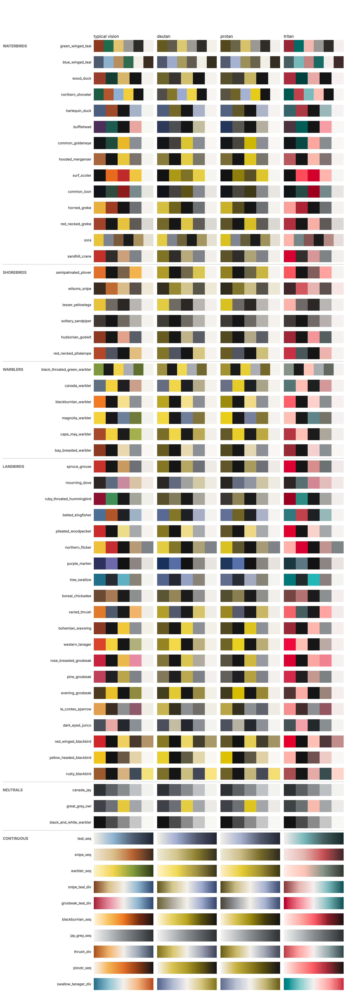

```{r, include = FALSE}
knitr::opts_chunk$set(collapse = TRUE, comment = "#>", fig.path = "man/figures/README-", out.width = "100%")
```

# borealfeathers

Colour palettes for data visualisation, inspired by birds of the North American
boreal forest and its wetlands.

> **Status:** the colours are a provisional first pass, picked by hand from typical
> plumage. They will be refined from photographs (see `data-raw/extract_colours.R`).

## Installation

```r
# install.packages("remotes")
remotes::install_github("USERNAME/borealfeathers")
```

## Usage

```{r example}
library(borealfeathers)
list_palettes("shorebirds")

get_pal("canada_warbler")
get_pal("blue_winged_teal", 3)
```

```{r ggplot, fig.height = 3.5}
library(ggplot2)
ggplot(iris, aes(Sepal.Length, Petal.Length, colour = Species)) +
  geom_point(size = 2) +
  scale_colour_boreal("blue_winged_teal") +
  theme_minimal()

ggplot(faithfuld, aes(waiting, eruptions, fill = density)) +
  geom_raster() +
  scale_fill_boreal("teal_seq", discrete = FALSE) +
  theme_minimal()
```

`get_pal(name, n)` returns the first `n` colours. Colours are stored with the
most distinct ones first, so small `n` still separates well.

## Palettes



```{r, echo = FALSE, results = "asis"}
i <- unique(boreal_palette_info[c("palette", "group", "species", "scientific_name", "plumage")])
cat("| Group | Palette | Species | Plumage |", "|---|---|---|---|",
    sprintf("| %s | `%s` | %s (*%s*) | %s |", i$group, i$palette, i$species, i$scientific_name, i$plumage), sep = "\n")
```

Which plumage patch each colour comes from is in `boreal_palette_info`.

Continuous palettes: `teal_seq`, `snipe_seq`, `warbler_seq`, `blackburnian_seq`,
`jay_grey_seq` and `plover_seq` (sequential, light to dark), plus `snipe_teal_div`, `grosbeak_teal_div`,
`thrush_div` and `swallow_tanager_div` (diverging, pale midpoint). The diverging palettes avoid a
red-green axis. The `neutrals` group (`canada_jay`, `great_grey_owl`,
`black_and_white_warbler`) and `jay_grey_seq` are greys for background or
reference layers.

Palettes are grouped as waterbirds, shorebirds, warblers, landbirds and
neutrals; filter with `list_palettes(group = ...)`.

## Accessibility

Every discrete palette keeps a minimum CIEDE2000 difference of at least 10
between any two colours under typical vision and under simulated deuteranopia,
protanopia and tritanopia (Machado et al. 2009). Lightness is spread
across each palette, so it also holds up reasonably in greyscale. Re-run
`data-raw/check_palettes.R` after changing any colour.

## Photo credits

See `inst/extdata/photo_credits.csv`.

## Related packages

[birdcolors](https://CRAN.R-project.org/package=birdcolors) (world birds),
[feathers](https://github.com/shandiya/feathers) (Australian birds) and
[Manu](https://github.com/G-Thomson/Manu) (New Zealand birds).
